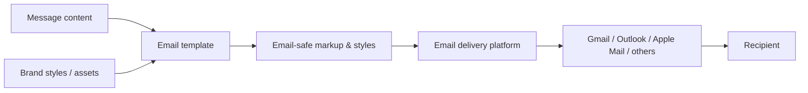
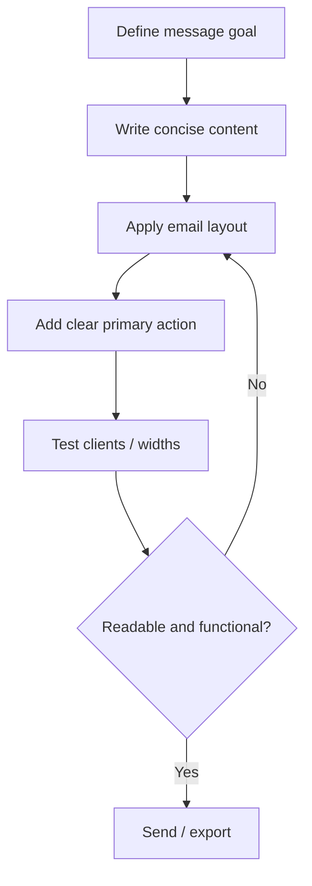
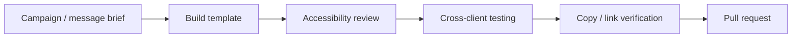

<div align="center">

# Email Template

**A reusable email-template project for building clear, responsive, brand-consistent messages that survive the wonderfully inconsistent universe of email clients.**


[Browse source](https://github.com/Nischhalsubba/Email-_template/tree/main) · [Issues](https://github.com/Nischhalsubba/Email-_template/issues)

</div>

## Overview

This repository contains email-template work intended to be understandable by designers, developers, marketers, and content editors. Email HTML has different constraints from normal web pages, so maintainability, fallback behavior, readable content, and real-client testing matter more than clever front-end tricks.

<details open>
<summary><strong>🏗️ Interactive email architecture</strong></summary>



</details>

## Message flow



## For each audience

| Audience | Focus |
|---|---|
| Developers | Compatible HTML, CSS fallbacks, links and rendering tests |
| Designers | Hierarchy, spacing, responsive behavior and brand consistency |
| Marketers | Message clarity, CTA hierarchy and campaign context |
| Content editors | Accurate copy, links, legal text and personalization fallbacks |

## Getting started

```bash
git clone https://github.com/Nischhalsubba/Email-_template.git
cd Email-_template
```

Open the maintained template files and use the tooling declared in the repository when present. Always test production email HTML in representative email clients before sending.

## Accessibility & delivery quality

Use meaningful link text, useful alt text, sufficient contrast, readable text sizes, a logical reading order, sensible image fallbacks, and a text-first message that still makes sense if remote images are blocked.

## SEO / discoverability

Email bodies themselves are not traditional SEO pages, but repository and documentation discoverability still matters. Use descriptive terms such as **responsive email template, HTML email, newsletter template, transactional email, email design, and email development** naturally in project descriptions and documentation.

## Contribution flow


